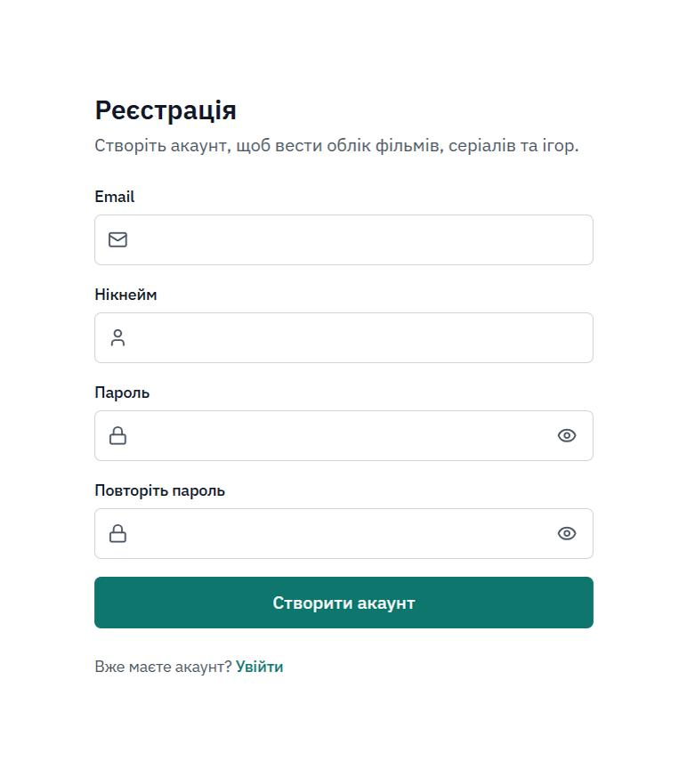
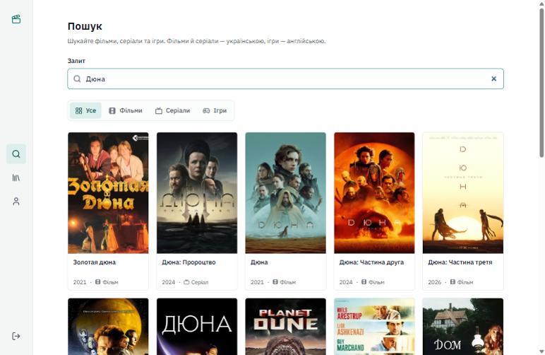
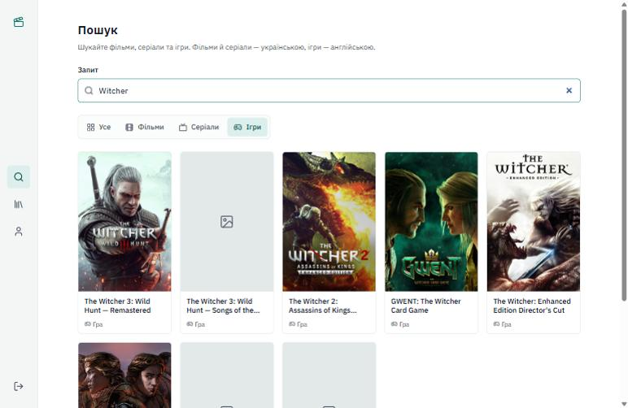
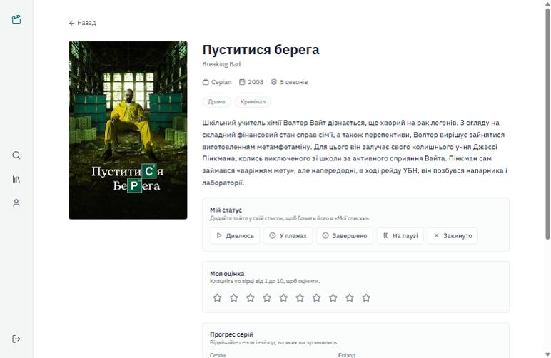
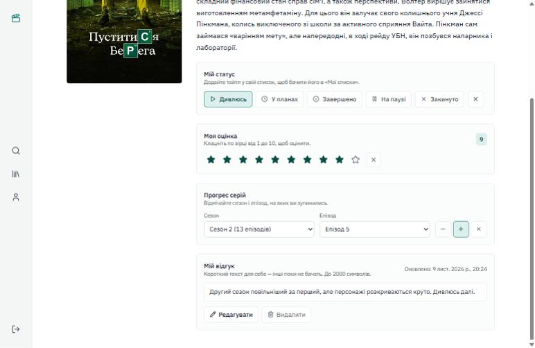
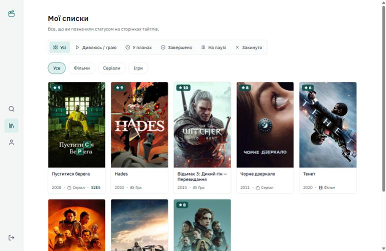
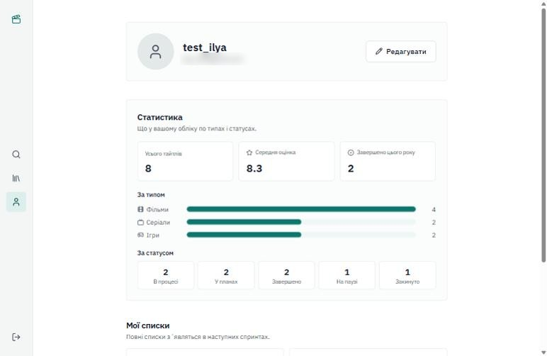

# Інструкція користувача MediaTrack

Сайт: https://mediatrack-7isg.onrender.com

Сайт на безкоштовному хостингу, тому після простою перше відкриття може тривати до хвилини.

Меню зліва складається з іконок: лупа відкриває пошук, книжки відкривають «Мої списки», чоловічок відкриває профіль, стрілка внизу означає вихід. Якщо навести на іконку, з'явиться підказка.

## 1. Реєстрація і вхід

1. На сторінці входу натисніть «Зареєструватися».
2. Введіть email, нікнейм і пароль (не коротше 8 символів), потім повторіть пароль.
3. Натисніть «Створити акаунт». Після цього відкриється пошук.

Наступного разу введіть email і пароль на сторінці входу і натисніть «Увійти».

## 2. Пошук

Введіть назву фільму, серіалу або гри. Вкладки «Усе», «Фільми», «Серіали» та «Ігри» звужують результати.

Фільми й серіали беруться з TMDB, ігри зі Steam. Якщо одне з джерел не відповідає, результати з іншого все одно з'являться.

## 3. Сторінка тайтлу

Натисніть на картку в результатах. На сторінці є постер, рік, жанри та опис. Якщо українського опису немає, буде англійський і позначка про це.

## 4. Статус

У блоці «Мій статус» оберіть один із варіантів:

| Статус | Коли обирати |
| --- | --- |
| Дивлюсь (для ігор «Граю») | дивитесь або граєте зараз |
| У планах | хочете подивитися або зіграти пізніше |
| Завершено | подивились або пройшли |
| На паузі | відклали, але повернетесь |
| Закинуто | далі не будете |

Статус можна міняти скільки завгодно. Хрестик праворуч від статусів прибирає тайтл зі списків.

## 5. Оцінка

У блоці «Моя оцінка» натисніть на зірку від 1 до 10. Хрестик поруч прибирає оцінку. Якщо тайтла ще немає у ваших списках, він додасться зі статусом «Завершено».

## 6. Відгук

У блоці «Мій відгук» напишіть текст до 2000 символів і натисніть «Зберегти». Потім його можна змінити кнопкою «Редагувати» або видалити кнопкою «Видалити». Відгук бачите тільки ви.

## 7. Прогрес серіалу

Цей блок є тільки у серіалів. У полях «Сезон» і «Епізод» оберіть, на чому зупинились. Кнопки «−» і «+» переводять на попередню або наступну серію, хрестик скидає прогрес. Вибрати серію, якої немає в серіалі, не вийде.

## 8. Мої списки

Тут усі тайтли, яким ви поставили статус. Верхній ряд кнопок фільтрує за статусом, нижній за типом. Натисніть на картку, щоб відкрити тайтл.

## 9. Профіль і статистика

Кнопка «Редагувати» дозволяє змінити нікнейм і посилання на аватар. Нижче статистика: скільки у вас тайтлів, як вони розподілені за типами і статусами, середня оцінка і скільки завершено цього року.

## Якщо щось не завантажується

Найчастіше сайт ще прокидається або TMDB чи Steam тимчасово не відповідає. Оновіть сторінку через хвилину.
